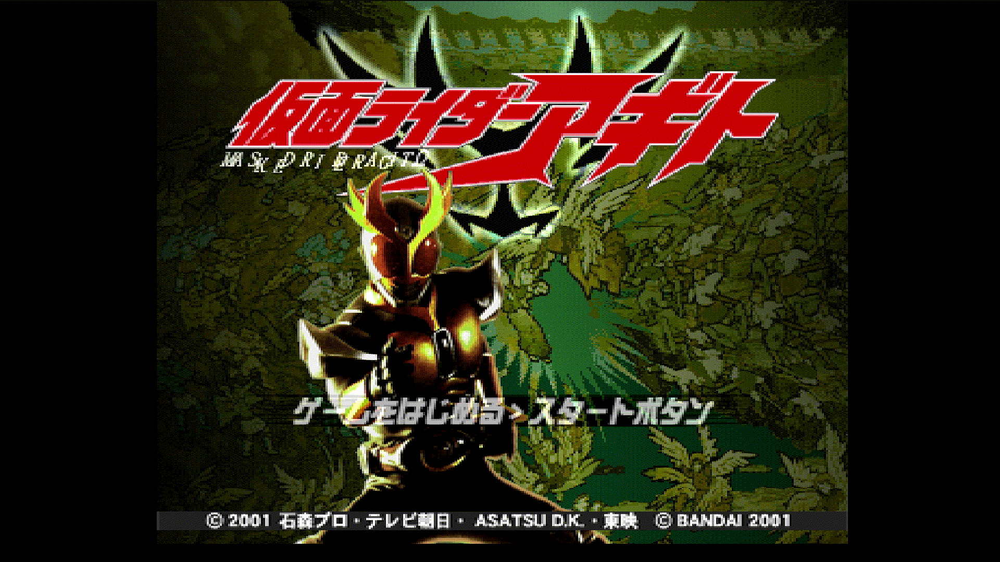
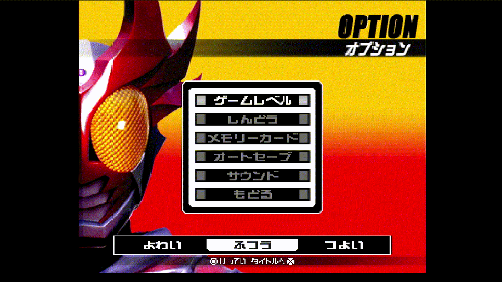
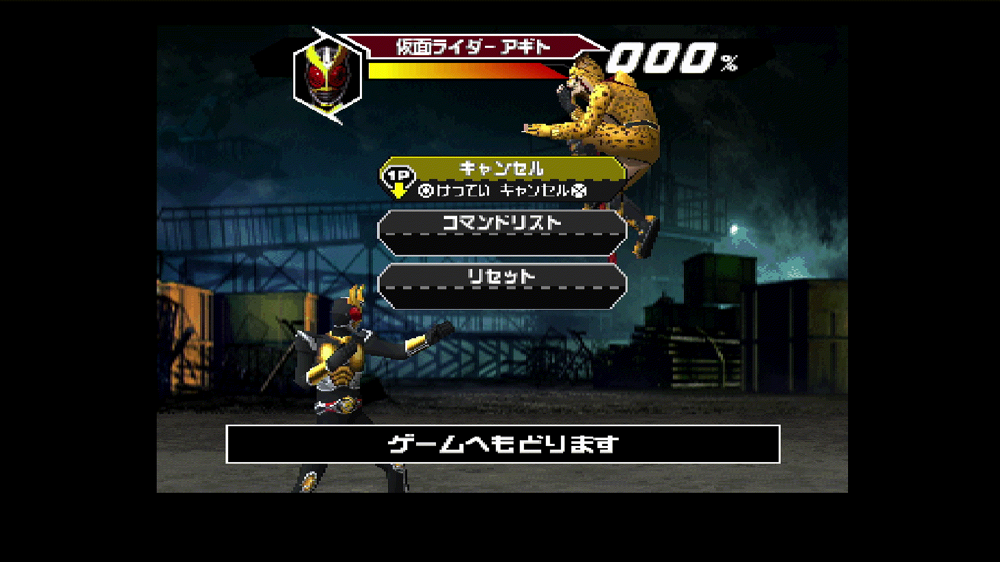
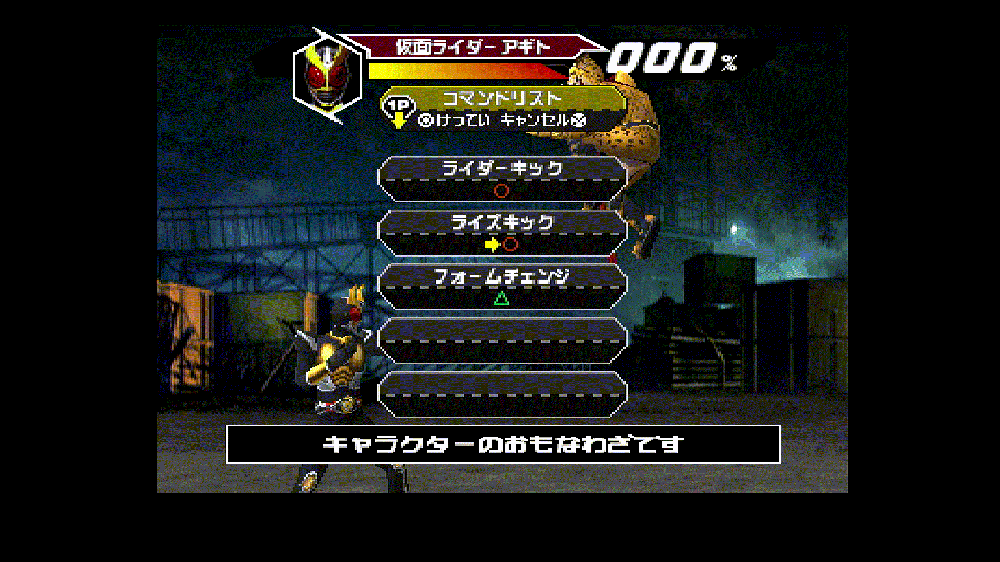
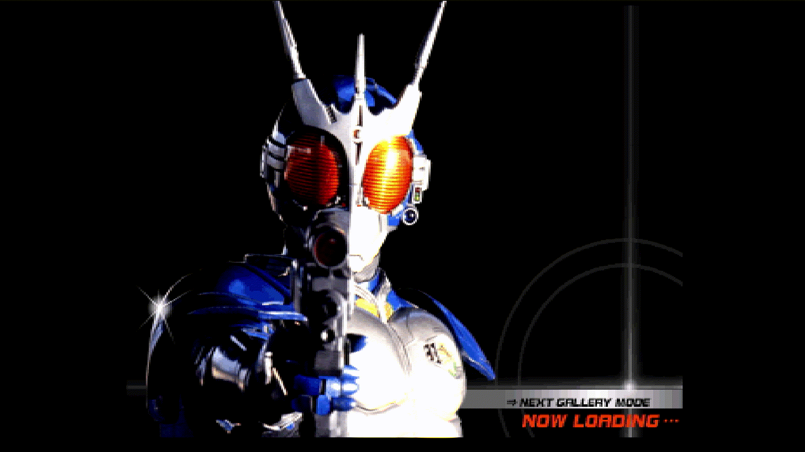
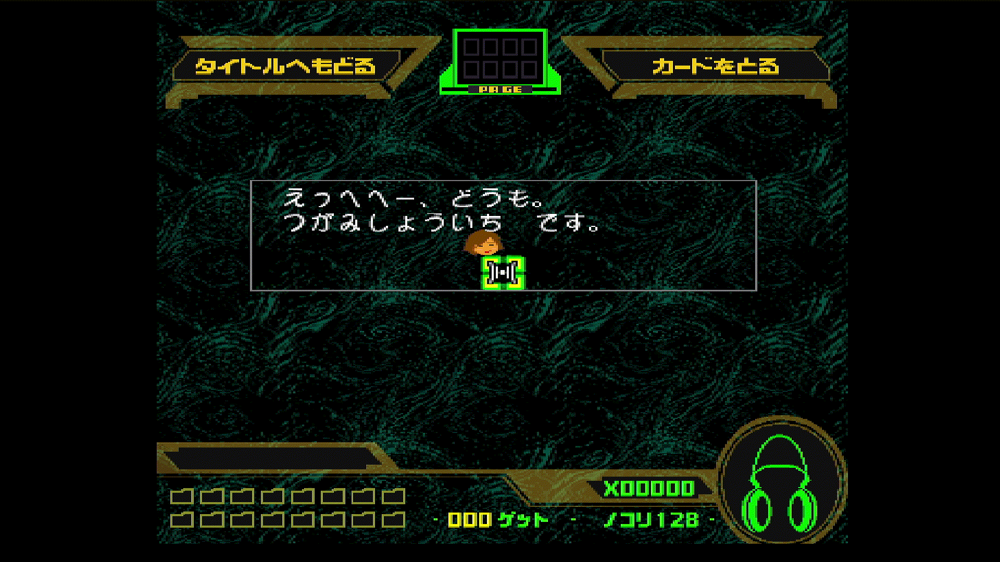

# [PS1] Kamen Rider Agito (Japan) — Patch de tradução (Português)

Tradução feita por fãs de **Kamen Rider Agito** (仮面ライダーアギト), lançado pela Bandai para PlayStation no Japão em 2001 (**SLPS-03344**).

> Projeto de fã, não oficial. Não tem ligação com Bandai, Toei, Ishimori Pro, TV Asahi ou ADK. **Nenhum dado do jogo é distribuído aqui.** Você precisa da sua própria cópia do jogo original japonês.



## Patches disponíveis

| Patch                                                | Idioma              | Observação        |
| ---------------------------------------------------- | ------------------- | ----------------- |
| `Kamen Rider Agito (Japan) - IA Traducao PT_BR v1.0` | Português do Brasil | Tradução completa |

Todos os patches são aplicados sobre o **mesmo `.bin` japonês original**. Escolha um: eles não podem ser combinados. As duas traduções já incluem o suporte ao GunCon.

---

## O que está traduzido

- **Menus:** menu de título, opções (inclusive o título OPÇÕES), menu de pausa e os rodapés de todas as telas.
- **Modo single-player (Agito):** avisos do tutorial, textos de fase/episódio e a tela de BALAS DE JOGO.
- **Seleção de personagem:** nomes dos personagens, painel de força/handicap, o letreiro "ESCOLHA LUTADOR" do fundo e o contador de vitórias.
- **Modo Versus:** tela de handicap, menus durante a luta e os efeitos de VENCEU / CONTINUAR.
- **Listas de golpes:** todos os personagens. Os nomes dos golpes foram mantidos como no original (Rider Kick, Flame Cutter…), por serem nomes oficiais. Só o comando "Form Change" virou "Mudar Forma".
- **G-Trailer:** personalização da unidade G3, editor de nome, textos de evolução e o rótulo NÍVEL.
- **Galeria (Character Get):**
  - Diálogos do Tsugami e do Hikawa.
  - As 128 descrições de cartas.
  - Botões, títulos, o rótulo PÁGINA, o contador de cartas e a tela de carregamento.
- **Memory Card Battle:** instruções e todos os comentários depois das lutas.
- **Memory card:** todas as mensagens e o título do save.
- **Vídeo de abertura:** legendas da música-tema.
- **Tela de aviso:** uma tela curta sobre o uso de IA, que aparece por 5 segundos antes do logo da Bandai.
- **Crédito:** uma linha de crédito da tradução na tela de título.

## O que NÃO está traduzido

- **Vídeo de créditos finais:** os nomes da equipe fazem parte do próprio vídeo.
- **Vozes e músicas:** o áudio não foi alterado.
- **Nomes de personagens e golpes:** mantidos como os nomes oficiais da série.

## Extra: GunCon na Galeria

Na Galeria (Character Get), dá para mirar com um **GunCon da Namco** ligado na **porta 1 ou na porta 2**. A mira segue a arma diretamente; o gatilho funciona como ○, o botão B como × e o botão A como START. Sem GunCon, nada muda.

- Para sair da Galeria com a arma, atire em "VOLTAR AO TÍTULO" na tela. A troca de página continua usando L/R num controle.
- No DuckStation, configure um **GunCon** em **Settings → Controllers**; o mouse faz o papel da arma.
- No console real, o GunCon só funciona em **TV de tubo (CRT)**.

---

## O que você precisa

1. **O jogo original japonês em um único BIN/CUE**, no formato Redump: `Kamen Rider Agito (Japan).bin` + `.cue`, MODE2/2352, uma faixa.

   Confira **antes** de aplicar o patch se o seu `.bin` é o mesmo:

   |         | Valor                                      |
   | ------- | ------------------------------------------ |
   | Tamanho | 202.996.416 bytes                          |
   | CRC32   | `77DF142E`                                 |
   | MD5     | `ccdc7dfd1f6fdbb8042a2137807e01f6`         |
   | SHA-1   | `89c9ce576b5575293b253638776222652b91a80a` |

   Se o seu dump estiver em outro formato (CHD, ISO, vários arquivos), converta antes para um único `.bin` + `.cue`. Para CHD, o `chdman extractcd` faz isso.

2. **O arquivo do patch** (`.xdelta`) do idioma que você quer, da página de Releases.

3. **Um aplicador de xdelta.** Qualquer um destes serve:
   - **Rom Patcher JS** (online, qualquer sistema): https://www.marcrobledo.com/RomPatcher.js/
   - **Delta Patcher** (Windows / Linux)
   - **xdelta UI** (Windows)
   - **xdelta3** (linha de comando, qualquer sistema)

---

## Como instalar

Os exemplos usam o patch em português.

### Opção A — Rom Patcher JS (mais fácil)

1. Abra o Rom Patcher JS no navegador.
2. **ROM file:** selecione `Kamen Rider Agito (Japan).bin`.
3. **Patch file:** selecione o patch `.xdelta`.
4. Clique em **Apply patch** e salve o resultado, por exemplo como `Kamen Rider Agito (PT-BR).bin`.

Os patches têm uns 19 MB, então a aplicação no navegador pode demorar um pouco.

### Opção B — Delta Patcher / xdelta UI

1. **Arquivo original:** `Kamen Rider Agito (Japan).bin`.
2. **Patch:** o `.xdelta`.
3. **Arquivo de saída:** `Kamen Rider Agito (PT-BR).bin`.
4. Clique em **Apply patch** (ou **Patch**).

### Opção C — linha de comando

```
xdelta3 -d -s "Kamen Rider Agito (Japan).bin" "Kamen Rider Agito (Japan) - IA Traducao PT_BR v1.0" "Kamen Rider Agito (PT-BR).bin"
```

### Crie o arquivo .cue

O `.bin` traduzido precisa de um `.cue` próprio.

1. Crie, ao lado do `.bin`, um arquivo de texto chamado `Kamen Rider Agito (PT-BR).cue` com este conteúdo:

   ```
   FILE "Kamen Rider Agito (PT-BR).bin" BINARY
     TRACK 01 MODE2/2352
       INDEX 01 00:00:00
   ```

2. O nome entre aspas precisa ser exatamente o nome do seu arquivo `.bin`.

Abra o `.cue` no emulador.

**Checksums esperados do `.bin` traduzido:**

| Patch                                              | CRC32      | SHA-1                                      |
| -------------------------------------------------- | ---------- | ------------------------------------------ |
| Kamen Rider Agito (Japan) - IA Traducao PT_BR v1.0 | `2B595873` | `729b481245b690228916024c204af8d90cde4a96` |

---

## Jogando

**Emuladores:** recomendamos o DuckStation. Outros emuladores precisos de PS1 também funcionam, como Beetle PSX ou PCSX-Redux.

**Console real:** o patch foi testado num PlayStation de verdade utilizando PicoStation, XStation e no PlayStation 2 com disco. Use um ODE (XStation, PSIO…) ou grave o `.bin`/`.cue` num CD-R para um console desbloqueado. O patch mantém válidos os dados de correção de erros do disco (EDC/ECC).

**Memory Card Battle:** precisa de **dois memory cards**, um em cada entrada, cada um com um save que tenha uma unidade G3. No DuckStation, configure um cartão para a porta 2 em **Settings → Memory Cards**.

**Saves antigos:** saves feitos na versão japonesa continuam funcionando. O título deles na tela do memory card só muda depois que você salvar de novo com o jogo traduzido.

---

## Sobre o uso de IA neste projeto

Esta tradução foi feita **com a ajuda de uma IA**: o Claude, da Anthropic, trabalhando junto com um humano.

**Feito pela IA:**

- Engenharia reversa do jogo: formatos de arquivo, codificação do texto, compressão, ponteiros, motor de texto.
- Criação das ferramentas de extração, inserção e build, da tela de aviso e do suporte ao GunCon.
- Tradução dos textos para o português e para o inglês.
- Redesenho dos gráficos com o texto traduzido.

**Feito pelo humano (IMPHOSTIL):**

- Dirigiu o projeto e decidiu o que traduzir e como.
- Escreveu as legendas da abertura e criou a tela de aviso.
- Testou cada tela no emulador e no console real, reportou cada problema com prints e revisou os resultados.

Por isso, algumas traduções podem não estar perfeitas. Vários textos também precisaram ser **encurtados** para caber no espaço fixo que o jogo reserva para eles, principalmente na Galeria e nos comentários do Memory Card Battle. Correções e sugestões são bem-vindas: abra uma _Issue_.

O processo completo está documentado, para que qualquer pessoa consiga reproduzir ou continuar o trabalho sem IA.

---

## Valorize os romhackers

Esta tradução foi feita com a ajuda de inteligência artificial. Ela não foi feita por uma equipe tradicional de tradução.

Valorize os grupos de tradução e os romhackers que fazem esse trabalho à mão. Eles passam meses, muitas vezes anos, em engenharia reversa, tradução, redesenho de gráficos e testes, sem IA e sem receber nada, só por amor a esses jogos. Foi graças ao trabalho deles que projetos como este se tornaram possíveis. Siga, dê os créditos e agradeça.

## Algumas imagens...











## Este patch é gratuito

**Este patch é gratuito e sempre será.** Foi feito de fã para fã. Não venda este patch, cópias do jogo já com o patch aplicado nem discos físicos que o incluam. Se você pagou por ele, foi enganado.

Este é um projeto de fã, não oficial e sem ligação com os detentores dos direitos.

---

## Créditos

|                                                       |                                                                    |
| ----------------------------------------------------- | ------------------------------------------------------------------ |
| Projeto, testes, legendas da abertura e tela de aviso | **IMPHOSTIL** - https://www.youtube.com/@imphostil                 |
| Engenharia reversa, ferramentas e tradução            | Claude (Anthropic), sob direção humana                             |
| Jogo original                                         | © 2001 Ishimori Pro · TV Asahi · Asatsu D.K. · Toei, © Bandai 2001 |

Apoie os lançamentos oficiais da franquia Kamen Rider.
